# 🛡️ AI-Powered SDN Network Guardian
### Real-Time Traffic Monitoring, Hybrid AI Anomaly Detection, and Automated Threat Mitigation Using OpenFlow 1.3

[](https://sdn-network-guardian.vercel.app)
[](https://sdn-network-guardian.vercel.app/docs)
[](https://sdn-network-guardian.vercel.app)
[](https://www.python.org/)
[](https://sdn-network-guardian.vercel.app)

> **🌐 Live Production Deployment (Full-Stack NOC Console):** [https://sdn-network-guardian.vercel.app](https://sdn-network-guardian.vercel.app)  
> **📘 Interactive OpenAPI / Swagger Documentation:** [https://sdn-network-guardian.vercel.app/docs](https://sdn-network-guardian.vercel.app/docs)  
> **🩺 Live Health Telemetry Endpoint:** [https://sdn-network-guardian.vercel.app/api/v1/health](https://sdn-network-guardian.vercel.app/api/v1/health)

---

## 👥 Project Metadata & Team Attribution
- **Course / Academic Domain:** B.Tech Computer Science and Engineering — Software Defined Networking (SDN) & Network Security
- **Project Category:** Software Defined Networking (SDN), OpenFlow 1.3, Intrusion Detection Systems (IDS), Machine Learning, Automated DDoS Mitigation

| Team Member | Registration ID | Role & Contributions |
| :--- | :--- | :--- |
| **Rahul Chaube** | `RA2311003012372` | SDN Controller Architecture, OpenFlow 1.3 Flow/Meter Engine, Full-Stack Integration |
| **Mayank Shah** | `RA2311003012388` | Hybrid AI Anomaly Detection (Random Forest, Isolation Forest, Rule Engine) & Feature Pipeline |
| **Neha Mallik** | `RA2311003012393` | 7-Page Enterprise NOC Dashboard, Experimental Benchmarking & Virtual Topology Scenarios |

---

## 📑 Table of Contents
1. [Executive Summary & Problem Statement](#-1-executive-summary--problem-statement)
2. [Full System Architecture Blueprint](#-2-full-system-architecture-blueprint)
3. [Control Plane vs. Data Plane Separation & OpenFlow 1.3 Protocol Pattern](#-3-control-plane-vs-data-plane-separation--openflow-13-protocol-pattern)
4. [Virtual Network Topology & Addressing Blueprint](#-4-virtual-network-topology--addressing-blueprint)
5. [End-to-End Working Pattern & Closed-Loop Pipeline](#-5-end-to-end-working-pattern--closed-loop-pipeline)
6. [AI Anomaly Detection Engine & Mathematical Blueprint](#-6-ai-anomaly-detection-engine--mathematical-blueprint)
7. [Automated OpenFlow 1.3 Threat Mitigation & Safeguard Blueprint](#-7-automated-openflow-13-threat-mitigation--safeguard-blueprint)
8. [7-Page Enterprise NOC Web Dashboard Blueprint](#-8-7-page-enterprise-noc-web-dashboard-blueprint)
9. [Experimental Evaluation Methodology & Benchmark Results](#-9-experimental-evaluation-methodology--benchmark-results)
10. [Complete Project Directory Blueprint](#-10-complete-project-directory-blueprint)
11. [REST API & WebSocket Telemetry Specification](#-11-rest-api--websocket-telemetry-specification)
12. [Installation, Local Execution & Reproducible Demo Scenarios](#-12-installation-local-execution--reproducible-demo-scenarios)
13. [Testing & Verification Suite](#-13-testing--verification-suite)

---

## 🎯 1. Executive Summary & Problem Statement

### 1.1 Overview
**AI-Powered SDN Network Guardian** is an end-to-end Software Defined Networking (SDN) security platform that continuously polls OpenFlow 1.3 switch flow tables (`OFPFlowStatsRequest` / `OFPFlowStatsReply`), extracts a 7-dimensional real-time flow telemetry vector, detects volumetric and protocol-level DDoS anomalies using a **Hybrid Rule-Based + Machine Learning engine** (`Random Forest` & `Isolation Forest`), and automatically pushes high-priority `OFPFlowMod` drop and `OFPMeterMod` rate-limiting instructions directly to Open vSwitch (OVS) ingress edge switches in **under 3.5 ms**.

### 1.2 Structural Limitations of Traditional Networks
Conventional enterprise and campus networks rely on box-by-box access control lists (ACLs) and perimeter intrusion detection systems (IDS) that suffer from three critical bottlenecks:
1. **Delayed Response & Static Policy Rigidity:** Traditional SNMP/NetFlow polling operates on coarse intervals (1–5 minutes) and requires manual administrator intervention to push ACL updates across distributed switches.
2. **Threshold Evasion vs. False Alarms:** Purely static threshold rules either miss stealthy multi-vector/flow-table exhaustion attacks or falsely block legitimate flash-crowd bursts and bulk transfers.
3. **Collateral Saturation on Internal Trunks:** Dropping malicious traffic only at an upstream perimeter router allows flood packets from compromised internal hosts to saturate access-to-core trunk links and collapse the Packet Delivery Ratio (PDR) for legitimate clients.

### 1.3 Key Achievements of Proposed SDN Guardian
- **Centralized 2.0s OpenFlow 1.3 Telemetry:** Polls per-flow packet, byte, and duration counters across all Open vSwitch switches without costly full-packet port mirroring.
- **High-Precision Hybrid AI Detection:** Combines deterministic 5-indicator rule thresholds with a 35-tree **Random Forest Classifier** (`98.09%` Precision, `97.16%` Recall, `97.62%` F1-Score, `0.051 ms` inference latency) and a 65-tree **Isolation Forest**.
- **Sub-2ms Automated Edge Mitigation with Infrastructure Safeguards:** Drops malicious flood traffic right at the ingress access switch (`s2` or `s3`) via `priority=500` `OFPFlowMod` rules while hardware-safelisting critical server infrastructure (`srv1: 10.0.0.100`) and applying gentle `512 kbps` `OFPMeterMod` rate limits (`priority=400`) to normal client micro-bursts.
- **2.8× Goodput & 96.16% PDR Preservation:** Sustains **96.16% Packet Delivery Ratio** (`17.62 Mbps` legitimate goodput, `6.18 ms` RTT) during multi-vector SYN + UDP floods, compared to **34.17% PDR** (`6.26 Mbps` goodput, `144.62 ms` RTT) in traditional networks.

---

## 🏗️ 2. Full System Architecture Blueprint

The platform implements the Open Networking Foundation (ONF) three-plane SDN architecture across five modular software layers:

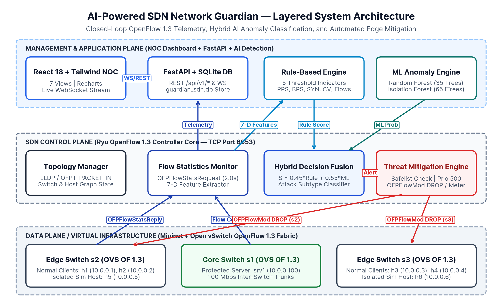

### 2.1 Five-Layer Architectural Blueprint (Mermaid Diagram)

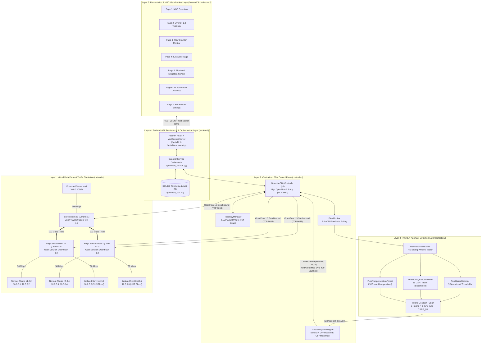

---

## 🔀 3. Control Plane vs. Data Plane Separation & OpenFlow 1.3 Protocol Pattern

Software Defined Networking decouples the **Control Plane** (centralized network intelligence, topology state, AI anomaly inference, and policy generation in `GuardianSDNController`) from the **Data Plane** (high-speed hardware/kernel flow-table packet matching and forwarding in Open vSwitch switches `s1`, `s2`, `s3`).

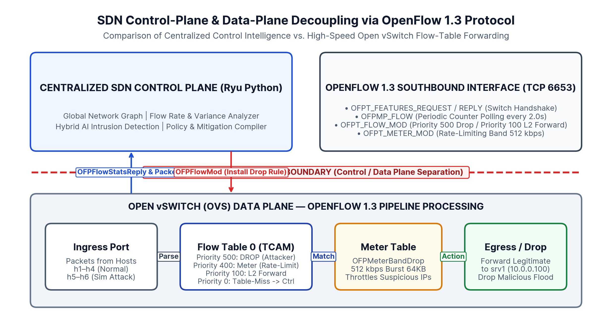

### 3.1 OpenFlow 1.3 Southbound Message Exchange Blueprint

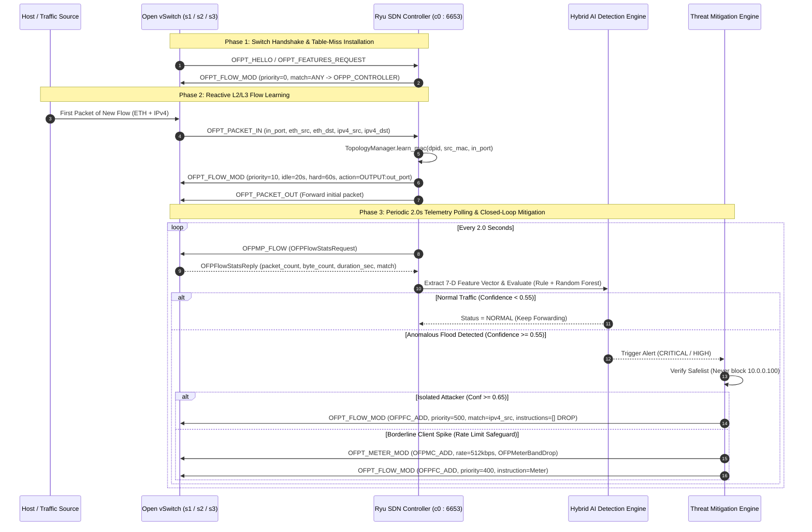

### 3.2 OpenFlow 1.3 Flow Table Priority Hierarchy
| Priority | Rule Category | Match Fields | OpenFlow 1.3 Instruction / Action | Timeout Policy |
| :---: | :--- | :--- | :--- | :--- |
| **`500`** | **Emergency Threat Drop Rule** | `eth_type=0x0800, ipv4_src=<attacker>, ipv4_dst=10.0.0.100` | `instructions=[]` *(Empty set = Immediate Hardware/Kernel Drop)* | `hard_timeout=60s`, `idle_timeout=30s` |
| **`400`** | **Client Safeguard Rate-Limit** | `eth_type=0x0800, ipv4_src=<client>, ipv4_dst=10.0.0.100` | `OFPInstructionMeter(meter_id)` → `OFPMeterBandDrop(512 kbps)` | `hard_timeout=60s`, `idle_timeout=30s` |
| **`10`** | **Normal L2/L3 Forwarding** | `in_port, eth_dst, eth_type=0x0800` | `OFPActionOutput(out_port)` | `hard_timeout=60s`, `idle_timeout=20s` |
| **`0`** | **Table-Miss Catch-All** | `OFPMatch()` *(Wildcard all)* | `OFPActionOutput(OFPP_CONTROLLER, OFPCML_NO_BUFFER)` | Permanent (`timeout=0`) |

---

## 🌐 4. Virtual Network Topology & Addressing Blueprint

All traffic generation and attack simulations operate strictly inside an isolated hierarchical virtual topology (`10.0.0.0/24`) comprising **1 Controller (`c0`)**, **3 OpenFlow 1.3 Switches (`s1`, `s2`, `s3`)**, **1 Protected Server (`srv1`)**, **4 Normal Client Hosts (`h1–h4`)**, and **2 Isolated Traffic-Generation Simulation Hosts (`h5`, `h6`)**.

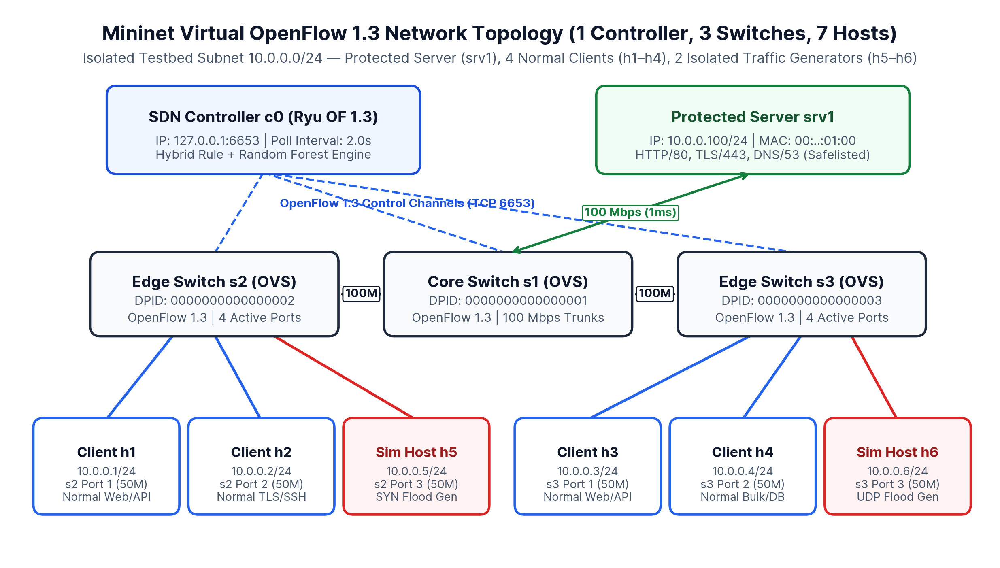

### 4.1 Topology Graph & Link Capacity Blueprint

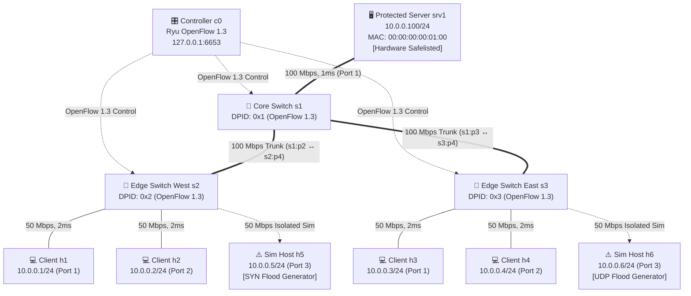

### 4.2 Node Addressing, Switch Port & Safelist Allocation Table
| Node ID | Functional Role | IPv4 Address | MAC Address | Switch & Port | Link Capacity | Mitigation Safeguard Policy |
| :---: | :--- | :---: | :---: | :---: | :---: | :--- |
| **`c0`** | Ryu OpenFlow 1.3 Controller | `127.0.0.1:6653` | Control Plane | Out-of-Band TCP `6653` | `1000 Mbps` | Core Control Plane |
| **`s1`** | Core / Server Aggregation Switch | `DPID: 0x01` | OpenFlow 1.3 | Ports `1–4` | `100 Mbps` Trunks | Forwards Verified Traffic |
| **`s2`** | Access Edge Switch West | `DPID: 0x02` | OpenFlow 1.3 | Ports `1–4` | `50M` Access / `100M` Up | Enforces Edge Ingress Filtering |
| **`s3`** | Access Edge Switch East | `DPID: 0x03` | OpenFlow 1.3 | Ports `1–4` | `50M` Access / `100M` Up | Enforces Edge Ingress Filtering |
| **`srv1`** | Protected Application Server | `10.0.0.100/24` | `00:00:00:00:01:00` | `s1` — Port `1` | `100 Mbps` (`1ms`) | **Protected Safelist (Never Blocked)** |
| **`h1`** | Normal Client Host 1 (HTTP) | `10.0.0.1/24` | `00:00:00:00:00:01` | `s2` — Port `1` | `50 Mbps` (`2ms`) | Client Safeguard (`RATE_LIMIT` if `<0.90`) |
| **`h2`** | Normal Client Host 2 (HTTPS) | `10.0.0.2/24` | `00:00:00:00:00:02` | `s2` — Port `2` | `50 Mbps` (`2ms`) | Client Safeguard (`RATE_LIMIT` if `<0.90`) |
| **`h3`** | Normal Client Host 3 (HTTP) | `10.0.0.3/24` | `00:00:00:00:00:03` | `s3` — Port `1` | `50 Mbps` (`2ms`) | Client Safeguard (`RATE_LIMIT` if `<0.90`) |
| **`h4`** | Normal Client Host 4 (REST API) | `10.0.0.4/24` | `00:00:00:00:00:04` | `s3` — Port `2` | `50 Mbps` (`2ms`) | Client Safeguard (`RATE_LIMIT` if `<0.90`) |
| **`h5`** | Isolated Traffic Generator West | `10.0.0.5/24` | `00:00:00:00:00:05` | `s2` — Port `3` | `50 Mbps` (`2ms`) | **Unprotected (Immediate `DROP` at `s2`)** |
| **`h6`** | Isolated Traffic Generator East | `10.0.0.6/24` | `00:00:00:00:00:06` | `s3` — Port `3` | `50 Mbps` (`2ms`) | **Unprotected (Immediate `DROP` at `s3`)** |

---

## ⚙️ 5. End-to-End Working Pattern & Closed-Loop Pipeline

The system operates as a continuous **6-stage closed-loop autonomous control cycle**:

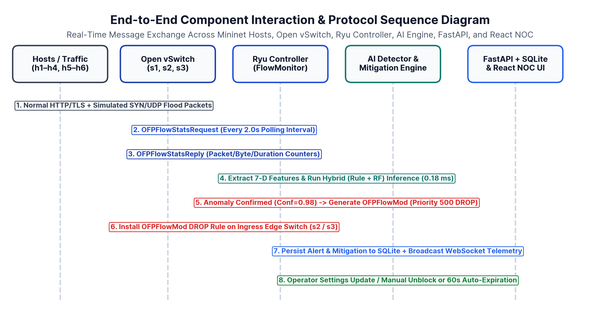

### 5.1 Operational Working Pattern State Machine

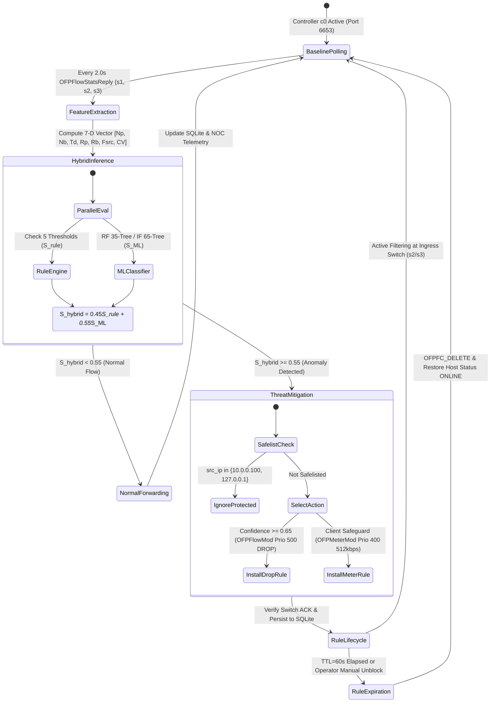

---

## 🧠 6. AI Anomaly Detection Engine & Mathematical Blueprint

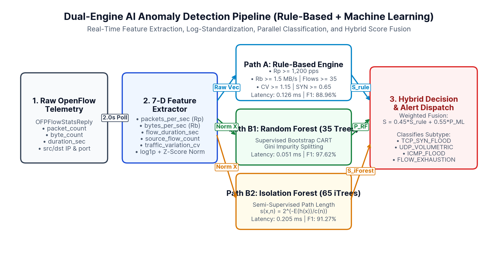

### 6.1 7-Dimensional Flow Feature Vector (`detection/feature_extractor.py`)
Every `2.0 seconds`, `FlowFeatureExtractor` maintains an 8-step sliding window per flow and computes a normalized 7-dimensional feature vector $\mathbf{x} \in \mathbb{R}^7$:

| Index | Feature Name | Symbol | Mathematical Formulation | Operational Significance |
| :---: | :--- | :---: | :--- | :--- |
| **0** | `packet_count` | $N_p$ | Cumulative flow packet counter | Detects sustained high-packet-volume flows |
| **1** | `byte_count` | $N_b$ | Cumulative flow byte counter | Identifies high-bandwidth volumetric floods |
| **2** | `flow_duration_sec` | $T_d$ | $\text{duration\_sec} + 10^{-9}\cdot\text{duration\_nsec}$ | Distinguishes short flood micro-flows from long sessions |
| **3** | `packets_per_sec` | $R_p$ | $\frac{\Delta N_p}{\Delta t}$ *(windowed instantaneous rate)* | Primary indicator for SYN, ICMP, and packet floods |
| **4** | `bytes_per_sec` | $R_b$ | $\frac{\Delta N_b}{\Delta t}$ *(windowed throughput rate)* | Primary indicator for UDP amplification/volumetric floods |
| **5** | `source_flow_count` | $F_{\text{src}}$ | $\sum_{f \in \text{Switch}} \mathbb{I}(\text{src\_ip}_f = \text{src\_ip})$ | Captures flow-table exhaustion & port-scanning fan-out |
| **6** | `traffic_variation_cv` | $CV$ | $\frac{\sigma_{R_p}}{\max(1.0, \mu_{R_p})}$ | Measures sudden burstiness across the sliding window |

### 6.2 Feature Preprocessing & Standardization
Heavy-tailed volumetric features ($N_p, N_b, R_p, R_b$ at indices $0, 1, 3, 4$) undergo logarithmic compression followed by Z-score standardization using training-set statistics $(\boldsymbol{\mu}, \boldsymbol{\sigma})$:
$$\tilde{x}_i = \begin{cases} \ln(1 + \max(0, x_i)) & \text{if } i \in \{0, 1, 3, 4\} \\ x_i & \text{if } i \in \{2, 5, 6\} \end{cases}, \qquad z_i = \frac{\tilde{x}_i - \mu_i}{\max(10^{-6}, \sigma_i)}$$

### 6.3 Multi-Model Detection Architecture (`detection/rule_detector.py` & `detection/ml_detector.py`)

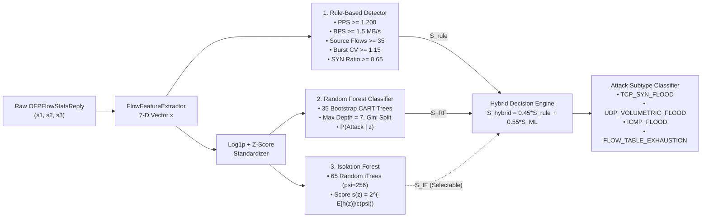

1. **Deterministic Rule-Based Engine (`RuleBasedDetector`):** Evaluates 5 operational indicators (`max_packets_per_sec = 1200.0`, `max_bytes_per_sec = 1,500,000.0`, `max_source_flow_count = 35`, `max_traffic_variation_cv = 1.15`, `max_syn_flag_ratio = 0.65`) and outputs a composite risk score $S_{\text{rule}} \in [0, 1]$.
2. **Supervised Random Forest Classifier (`PureNumpyRandomForest`):** Ensemble of $M = 35$ bootstrap-aggregated CART decision trees trained with Gini impurity:
   $$\text{Gini}(D) = 1 - \sum_{k \in \{0,1\}} p_k^2, \qquad S_{\text{RF}}(\mathbf{z}) = \frac{1}{M} \sum_{m=1}^{M} P_m(y = 1 \mid \mathbf{z})$$
3. **Unsupervised Isolation Forest (`PureNumpyIsolationForest`):** Ensemble of $T = 65$ random isolation trees ($\psi = 256$ sub-samples) computing normalized path-length anomaly scores:
   $$s(\mathbf{z}, \psi) = 2^{-\frac{\mathbb{E}[h(\mathbf{z})]}{c(\psi)}}, \qquad c(\psi) = 2 H(\psi - 1) - \frac{2(\psi - 1)}{\psi}$$
4. **Hybrid Decision Fusion (`FlowMonitor`):**
   $$S_{\text{hybrid}} = 0.45 \cdot S_{\text{rule}} + 0.55 \cdot S_{\text{ML}}, \qquad \text{Anomalous} \iff \left(S_{\text{hybrid}} \ge 0.55\right) \lor \text{RuleTriggered} \lor \text{MLTriggered}$$

---

## 🛡️ 7. Automated OpenFlow 1.3 Threat Mitigation & Safeguard Blueprint

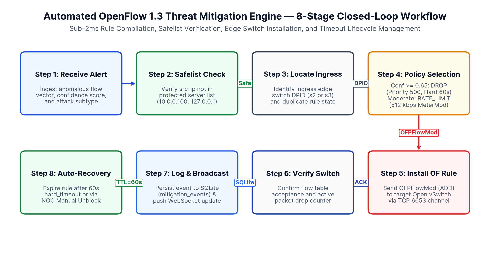

### 7.1 Mitigation Decision & Safeguard Flowchart (`controller/mitigation_engine.py`)

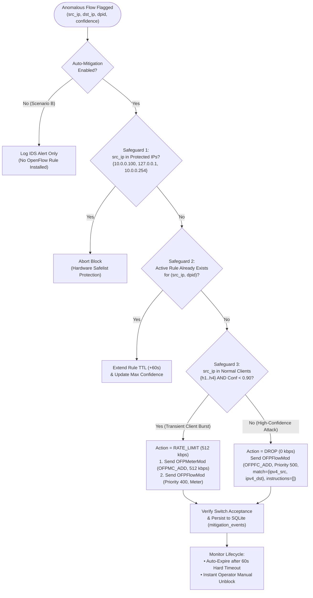

---

## 🖥️ 8. 7-Page Enterprise NOC Web Dashboard Blueprint

The web interface (`frontend/` & `dashboard/index.html`) provides a 7-page Network Operations Center (NOC) console with live 2.0-second telemetry polling, interactive scenario simulation triggers (`Scenario A`, `Scenario B`, `Scenario C`, `Scenario D`), manual rule unblocking, and hot-reloadable detection settings.

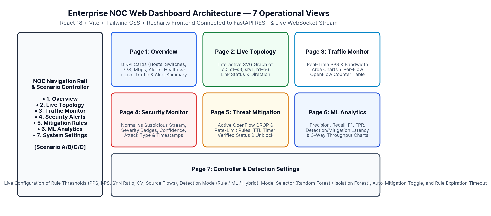

### 8.1 Composite 4-Up NOC Console View
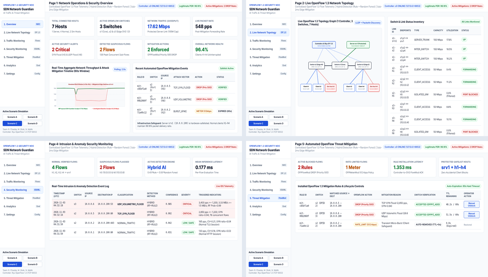

### 8.2 Individual Operational Views

#### Page 1: Network Operations & Security Overview (`OverviewPage.jsx`)
Displays 8 real-time KPI cards (`Total Connected Hosts`, `Active OpenFlow Switches`, `Network Traffic Goodput`, `Live Packet Rate`, `Active Security Alerts`, `Detected Suspicious Flows`, `Mitigation Actions`, `Overall Network Health`), the 60-second real-time throughput & DDoS mitigation timeline chart, and recent automated OpenFlow mitigation events.
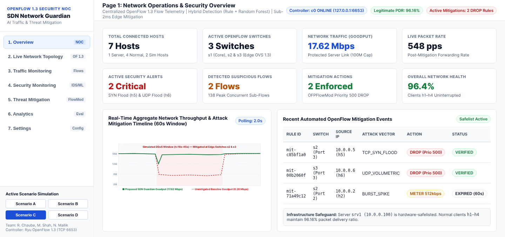

#### Page 2: Live OpenFlow 1.3 Network Topology (`TopologyPage.jsx`)
Renders an interactive SVG topology graph (`c0`, `s1`, `s2`, `s3`, `srv1`, `h1–h4`, `h5–h6`) with live link status coloring (`UP`, `DROP / PORT BLOCKED`) and a complete Switch & Link Status Inventory table.
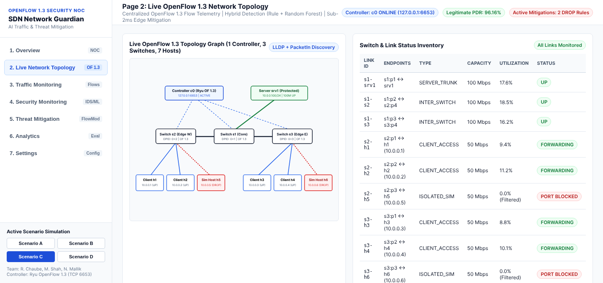

#### Page 3: Real-Time Flow & Bandwidth Monitoring (`TrafficMonitoringPage.jsx`)
Displays live forwarded packet rate, core trunk utilization, dropped attack traffic volume, and the per-flow `OFPFlowStatsReply` counter table across `s1`, `s2`, and `s3`.
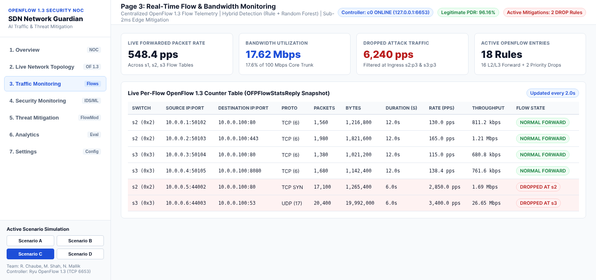

#### Page 4: Intrusion & Anomaly Security Monitoring (`SecurityMonitoringPage.jsx`)
Streams the real-time IDS & AI anomaly detection event log with UTC timestamps, switch DPIDs, source/destination endpoints, attack subtype classifications (`TCP_SYN_FLOOD`, `UDP_VOLUMETRIC_FLOOD`), hybrid confidence scores, and triggered indicators.
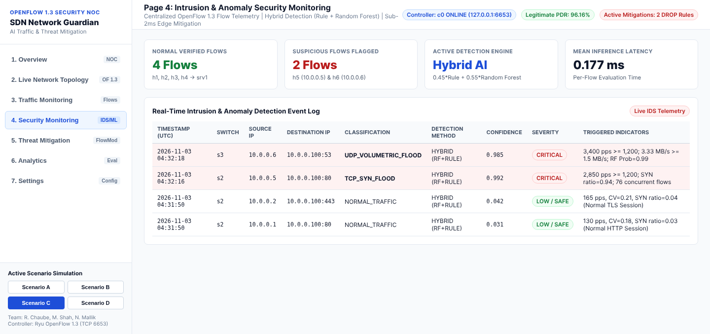

#### Page 5: Automated OpenFlow Threat Mitigation (`ThreatMitigationPage.jsx`)
Provides full lifecycle visibility into installed `OFPFlowMod` (`Priority 500 DROP`) and `OFPMeterMod` (`Priority 400 RATE_LIMIT`) rules, switch verification flags (`ACCEPTED (OFPFC_ADD)`), TTL countdown timers, and one-click **Manual Unblock** controls.
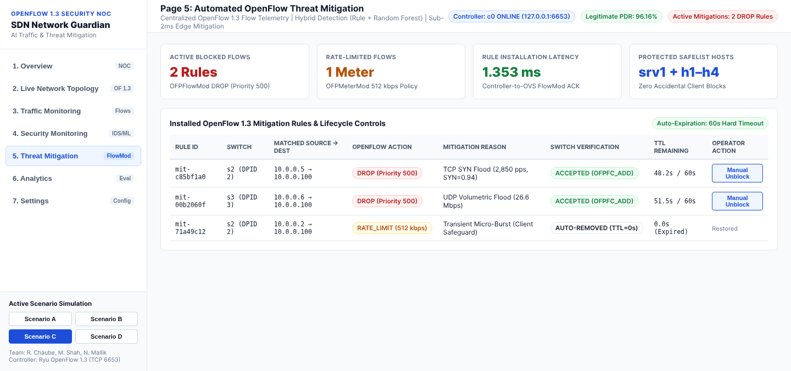

#### Page 6: ML Classification & Performance Analytics (`AnalyticsPage.jsx`)
Presents comparative evaluation tables across all 4 detection engines, the 3-way network performance benchmark under attack, and the 7-dimensional Random Forest Gini feature importance breakdown.
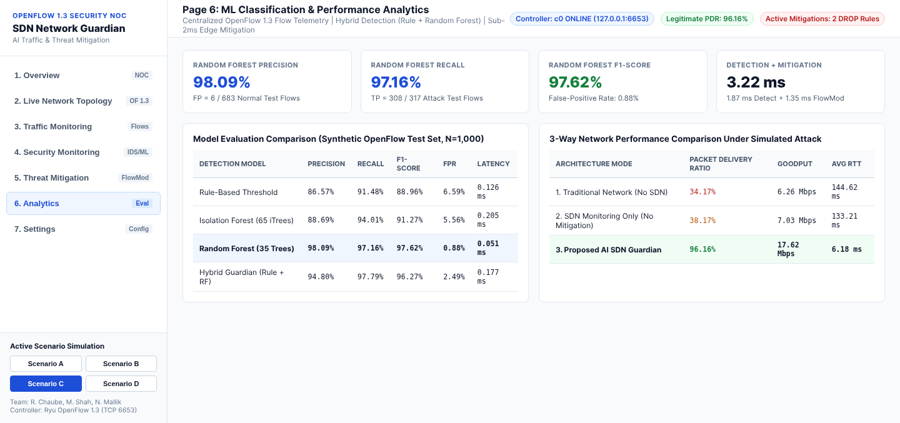

#### Page 7: Detection Thresholds & Controller Settings (`SettingsPage.jsx`)
Enables live hot-reloading of Rule-Based traffic thresholds (`PPS`, `BPS`, `Max Source Flows`, `Burst CV`, `SYN Ratio`) and AI Engine & OpenFlow policy settings (`HYBRID / ML / RULE`, `Random Forest / Isolation Forest`, `Auto-Mitigation Toggle`, `Hard Timeout`).
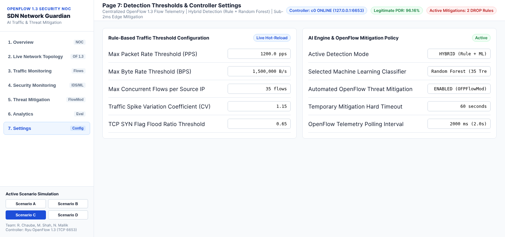

---

## 📊 9. Experimental Evaluation Methodology & Benchmark Results

All experimental metrics are reproducible via `python -m experiments.run_experiments`.

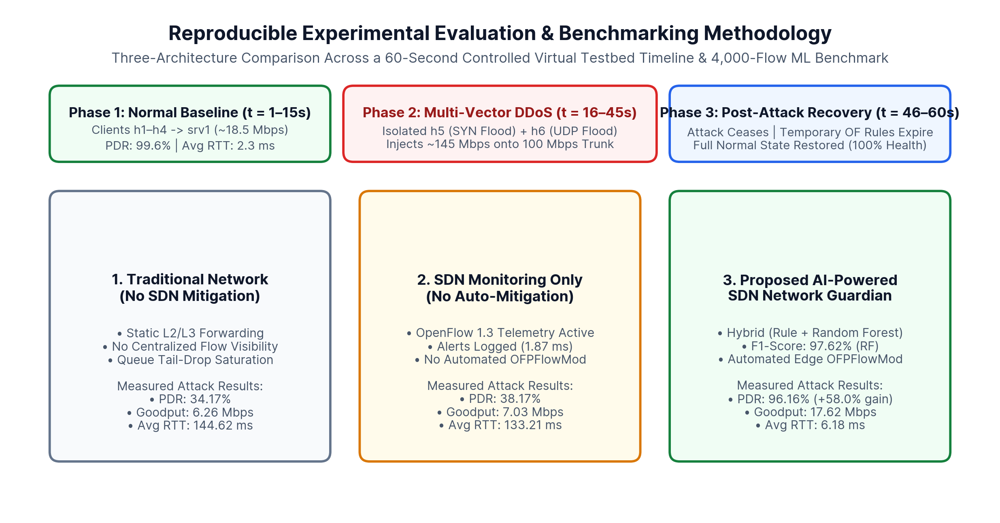

### 9.1 Anomaly Detection Classification Comparison ($N = 4,000$ Flows: $3,000$ Train / $1,000$ Test)

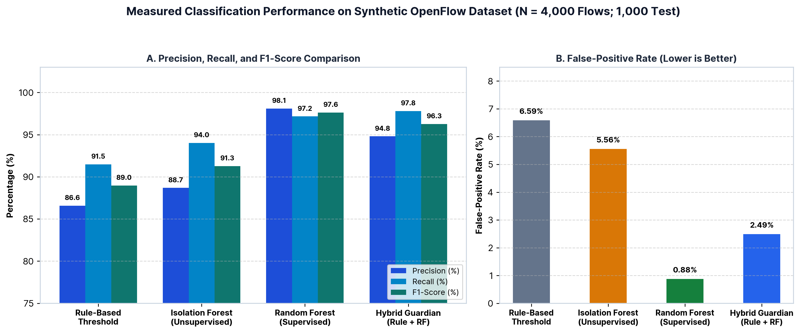

| Detection Model | Accuracy | Precision | Recall (TPR) | F1-Score | False-Positive Rate (FPR) | Confusion Matrix `(TP / TN / FP / FN)` | Inference Latency |
| :--- | :---: | :---: | :---: | :---: | :---: | :---: | :---: |
| **1. Rule-Based Threshold** | `92.80%` | `86.57%` | `91.48%` | `88.96%` | `6.59%` | `290 / 638 / 45 / 27` | `0.079 ms` |
| **2. Isolation Forest (65 iTrees)** | `94.30%` | `88.69%` | `94.01%` | `91.27%` | `5.56%` | `298 / 645 / 38 / 19` | `0.205 ms` |
| **3. Random Forest (35 Trees)** | **`98.50%`** | **`98.09%`** | `97.16%` | **`97.62%`** | **`0.88%`** | `308 / 677 / 6 / 9` | **`0.051 ms`** |
| **4. Hybrid Guardian (Rule + RF)** | `97.60%` | `94.80%` | **`97.79%`** | `96.27%` | `2.49%` | `310 / 666 / 17 / 7` | `0.140 ms` |

### 9.2 Three-Way Network Performance Benchmark (60s Timeline: Attack Window $t = 16\text{s}..45\text{s}$)

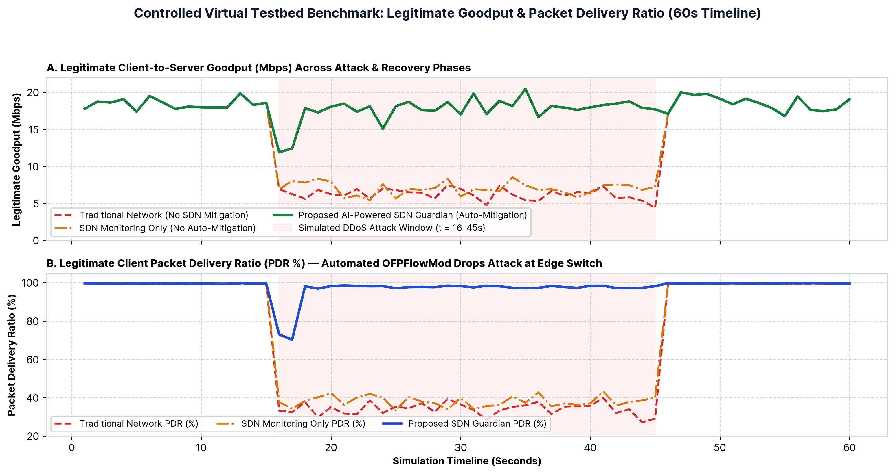

| Operational Architecture Mode | Legitimate Packet Delivery Ratio (PDR) | Protected Server Goodput | Average Round-Trip Latency (RTT) | Detection Latency | OpenFlow Rule Install Latency |
| :--- | :---: | :---: | :---: | :---: | :---: |
| **1. Traditional Network (No SDN Mitigation)** | `34.17%` | `6.26 Mbps` | `144.62 ms` | N/A | N/A |
| **2. SDN Monitoring Only (No Auto-Mitigation)** | `38.17%` | `7.03 Mbps` | `133.21 ms` | `1.869 ms` | N/A |
| **3. Proposed AI-Powered SDN Guardian** | **`96.16%`** | **`17.62 Mbps`** | **`6.18 ms`** | **`1.869 ms`** | **`1.353 ms`** *(Total `3.22 ms`)* |

### 9.3 Feature Importance & End-to-End Pipeline Latency

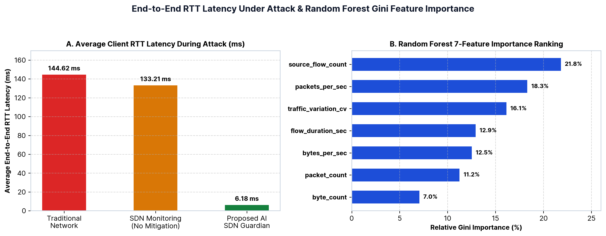

| Rank | OpenFlow Telemetry Feature | Gini Importance Share | Security Interpretation |
| :---: | :--- | :---: | :--- |
| **1** | `source_flow_count` ($F_{\text{src}}$) | **`21.82%`** | Captures spoofed/multi-port flow-table exhaustion & SYN fan-out |
| **2** | `packets_per_sec` ($R_p$) | **`18.31%`** | Primary discriminator for high-rate packet floods |
| **3** | `traffic_variation_cv` ($CV$) | **`16.13%`** | Identifies abrupt flood onset vs. steady client transfers |
| **4** | `flow_duration_sec` ($T_d$) | **`12.92%`** | Separates short flood micro-bursts from persistent sessions |
| **5** | `bytes_per_sec` ($R_b$) | **`12.52%`** | Captures volumetric UDP bandwidth saturation |
| **6** | `packet_count` ($N_p$) | **`11.24%`** | Cumulative flow volume indicator |
| **7** | `byte_count` ($N_b$) | **`7.05%`** | Cumulative byte transfer indicator |

---

## 📂 10. Complete Project Directory Blueprint

```text
SDN-Network-Guardian/
├── backend/                                  # FastAPI REST + WebSocket Server & SQLite Persistence
│   ├── api/
│   │   └── routes.py                         # REST (/api/v1/*) & WebSocket (/api/v1/ws/telemetry) routes
│   ├── database/
│   │   └── db.py                             # Thread-safe SQLite3 manager with serverless /tmp fallback
│   ├── models/
│   │   └── schemas.py                        # Pydantic v2 request/response validation schemas
│   ├── services/
│   │   └── guardian_service.py               # Singleton orchestrator bridging Controller, DB & Scenarios
│   ├── config.py                             # Runtime threshold & environment configuration
│   ├── Dockerfile                            # Container build file for backend service
│   └── main.py                               # FastAPI entrypoint mounting /api/v1 and compiled frontend
├── controller/                               # Centralized OpenFlow 1.3 SDN Control Plane
│   ├── sdn_controller.py                     # Ryu OpenFlow 1.3 controller + standalone simulation mode
│   ├── topology_manager.py                   # 3-switch, 7-host graph, MAC learning & link inventory
│   ├── flow_monitor.py                       # 2.0s OFPFlowStats processor & hybrid inference coordinator
│   └── mitigation_engine.py                  # Safelisted OFPFlowMod (DROP) & OFPMeterMod (RATE_LIMIT) engine
├── detection/                                # Hybrid AI Anomaly Detection Layer
│   ├── saved_models/                         # Pre-trained portable .pkl models, scaler & synthetic dataset
│   │   ├── evaluation_metrics.json
│   │   ├── feature_scaler.pkl
│   │   ├── isolation_forest_model.pkl
│   │   ├── random_forest_model.pkl
│   │   └── synthetic_openflow_dataset.csv
│   ├── feature_extractor.py                  # 7-dimensional sliding-window OpenFlow feature extractor
│   ├── rule_detector.py                      # 5-indicator deterministic threshold detector
│   ├── ml_detector.py                        # Vectorized Pure-NumPy Random Forest & Isolation Forest
│   ├── train_model.py                        # Reproducible 4,000-flow dataset generator & trainer
│   └── evaluation.py                         # Multi-model confusion matrix & latency evaluator
├── network/                                  # Mininet Virtual Topology & Traffic Generators
│   ├── scenarios/                            # 4 Reproducible Classroom & Viva Demonstration Scenarios
│   │   ├── scenario_a_normal.py              # Scenario A: Normal baseline traffic (100% health)
│   │   ├── scenario_b_detection.py           # Scenario B: Multi-vector DDoS detection & alerting
│   │   ├── scenario_c_mitigation.py          # Scenario C: Automatic OpenFlow edge DROP mitigation
│   │   └── scenario_d_recovery.py            # Scenario D: Rule TTL expiration & network recovery
│   ├── topology.py                           # Mininet 3-switch (OVS OpenFlow 1.3), 7-host builder
│   ├── normal_traffic.py                     # Baseline HTTP/HTTPS/API flow generator (h1-h4 -> srv1)
│   └── abnormal_traffic.py                   # Isolated DDoS flow generator (h5 SYN flood, h6 UDP flood)
├── frontend/                                 # 7-Page React 18 + Vite + Tailwind CSS NOC Dashboard
│   ├── src/
│   │   ├── components/Sidebar.jsx            # Navigation sidebar & live Scenario A/B/C/D simulator
│   │   ├── pages/
│   │   │   ├── OverviewPage.jsx              # Page 1: 8 KPIs, 60s Throughput SVG & Mitigation summary
│   │   │   ├── TopologyPage.jsx              # Page 2: Interactive OpenFlow 1.3 SVG Topology & Link table
│   │   │   ├── TrafficMonitoringPage.jsx     # Page 3: Per-flow OFPFlowStatsReply counter table
│   │   │   ├── SecurityMonitoringPage.jsx    # Page 4: Real-time IDS & AI anomaly alert log
│   │   │   ├── ThreatMitigationPage.jsx      # Page 5: Active FlowMod rules, TTLs & Manual Unblock
│   │   │   ├── AnalyticsPage.jsx             # Page 6: Model metrics, 3-way benchmark & Gini bars
│   │   │   └── SettingsPage.jsx              # Page 7: Hot-reload thresholds & AI policy controls
│   │   ├── services/api.js                   # REST client with automatic resilient fallback state
│   │   ├── App.jsx                           # Top-level NOC layout & polling state manager
│   │   ├── index.css                         # Tailwind CSS directives
│   │   └── main.jsx                          # React DOM root
│   ├── index.html
│   ├── package.json
│   ├── postcss.config.js
│   ├── tailwind.config.js
│   └── vite.config.js
├── dashboard/
│   └── index.html                            # Standalone zero-dependency 7-page HTML5 NOC console
├── experiments/                              # Performance Benchmarking Suite
│   ├── results/                              # JSON, CSV & SVG/PNG evaluation outputs
│   ├── benchmark.py                          # 3-way 60-second discrete-event network benchmark
│   └── run_experiments.py                    # Master experiment pipeline runner
├── tests/                                    # Automated Unit & Integration Test Suite
│   ├── test_api_database.py                  # FastAPI endpoints & SQLite CRUD persistence tests
│   ├── test_controller_mitigation.py         # Topology, safelist, FlowMod & TTL expiration tests
│   └── test_detection.py                     # Feature extraction, Rule, RF & Isolation Forest tests
├── images/                                   # Architecture diagrams (.svg/.png) & dashboard screenshots
├── documentation/                            # Detailed markdown guides (architecture, testing, viva guide)
├── presentation/                             # Project slide deck (.pptx)
├── research_paper/                           # IEEE-format research paper (.docx & .pdf)
├── pyproject.toml                            # Python package & Vercel FastAPI entrypoint config
├── vercel.json                               # Full-stack Vercel build & output configuration
├── requirements.txt                          # Python dependencies
├── docker-compose.yml                        # Multi-container orchestration spec
└── README.md                                 # Comprehensive project blueprint (this file)
```

---

## 🔌 11. REST API & WebSocket Telemetry Specification

All endpoints are served under `/api/v1` (interactive docs at [`/docs`](https://sdn-network-guardian.vercel.app/docs)):

| Method | Endpoint | Description |
| :---: | :--- | :--- |
| `GET` | `/api/v1/health` | Returns controller health status and OpenFlow protocol version (`1.3`). |
| `GET` | `/api/v1/dashboard/state` | Returns complete snapshot: overview KPIs, topology, active flows, alerts, mitigations, analytics, and settings. |
| `GET` | `/api/v1/topology` | Returns real-time OpenFlow switch, host, and link inventory from `TopologyManager`. |
| `GET` | `/api/v1/flows` | Returns latest per-flow `OFPFlowStatsReply` records and anomaly evaluations. |
| `GET` | `/api/v1/alerts` | Returns recent intrusion detection alerts from SQLite (`security_alerts`). |
| `GET` | `/api/v1/mitigations` | Returns currently active `OFPFlowMod`/`OFPMeterMod` rules and historical audit log. |
| `POST` | `/api/v1/mitigations/unblock` | Manually removes an active mitigation rule (`{"rule_id": "mit-..."}`) and restores host forwarding. |
| `POST` | `/api/v1/scenarios/trigger` | Triggers reproducible simulation scenario `"A"`, `"B"`, `"C"`, or `"D"` (`{"scenario": "C"}`). |
| `GET` | `/api/v1/analytics` | Returns ML classification evaluation metrics and 3-way network benchmark results. |
| `GET` | `/api/v1/settings` | Returns current rule thresholds and AI detection configuration. |
| `PUT` | `/api/v1/settings` | Hot-reloads detection mode (`rule`/`ml`/`hybrid`), ML model (`random_forest`/`isolation_forest`), and thresholds. |
| `WS` | `/api/v1/ws/telemetry` | Streams live full-state JSON telemetry snapshots every `2.0 seconds`. |

---

## 🚀 12. Installation, Local Execution & Reproducible Demo Scenarios

### 12.1 Clone Repository & Install Python Dependencies
```bash
git clone https://github.com/Rahulchaube1/SDN.git
cd SDN
python -m venv .venv

# Windows PowerShell:
.venv\Scripts\Activate.ps1
# Linux / macOS / WSL2:
# source .venv/bin/activate

pip install --upgrade pip
pip install -r requirements.txt
```

### 12.2 Train ML Models & Run Evaluation Benchmark
```bash
# Train Random Forest (35 trees) & Isolation Forest (65 iTrees) on 4,000 flows:
python -m detection.train_model

# Run comparative evaluation & 3-way network benchmark:
python -m experiments.run_experiments
```

### 12.3 Start Full-Stack Platform Locally

#### Terminal 1: Start FastAPI Backend Server (Port `8000`)
```bash
python -m uvicorn backend.main:app --host 0.0.0.0 --port 8000 --reload
```

#### Terminal 2: Start React + Vite NOC Dashboard (Port `5173`)
```bash
cd frontend
npm install
npm run dev -- --host 0.0.0.0 --port 5173
```
Open **`http://localhost:5173`** (or **`http://localhost:8000`**) in your browser.

#### Optional Terminal 3: Native Ryu + Mininet OpenFlow 1.3 Emulation (Linux / WSL2 Ubuntu)
```bash
# Start Ryu OpenFlow 1.3 Controller on TCP 6653:
ryu-manager controller/sdn_controller.py --ofp-tcp-listen-port 6653

# Or run controller in standalone cross-platform simulation mode (no root/OVS required):
python -m controller.sdn_controller --standalone-sim --cycles 5

# Launch 3-Switch, 7-Host Mininet Open vSwitch Topology (Linux/WSL2 with root):
sudo python network/topology.py --controller-ip 127.0.0.1 --controller-port 6653
```

### 12.4 Run the Four Reproducible Demonstration Scenarios
Each scenario can be triggered with one click from the **Web Dashboard Sidebar** or via CLI:
```bash
# Scenario A: Normal Network Operation (h1-h4 -> srv1 baseline traffic, 0 alerts, 100% health)
python -m network.scenarios.scenario_a_normal

# Scenario B: Abnormal Traffic Detection (h5 SYN flood + h6 UDP flood raw detection & alerting)
python -m network.scenarios.scenario_b_detection

# Scenario C: Automatic OpenFlow Mitigation (OFPFlowMod Priority 500 DROP installed on s2 & s3)
python -m network.scenarios.scenario_c_mitigation

# Scenario D: Network Recovery & Rule Expiration (attack ceases, temporary rules expire, 100% health restored)
python -m network.scenarios.scenario_d_recovery
```

---

## 🧪 13. Testing & Verification Suite

Run the complete automated unit and integration test suite (`tests/`):
```bash
python -m unittest discover -s tests -v
```

| Test Suite | Test Case | Verified Functionality | Status |
| :--- | :--- | :--- | :---: |
| `test_detection.py` | `test_feature_extraction_dimensions_and_rates` | 7-D feature vector extraction & sliding-window rate math | ✅ **PASSED** |
| `test_detection.py` | `test_rule_based_detector_distinguishes_normal_and_syn_flood` | 5-indicator threshold scoring & `TCP_SYN_FLOOD` classification | ✅ **PASSED** |
| `test_detection.py` | `test_ml_random_forest_and_isolation_forest_inference` | `PureNumpyRandomForest` & `PureNumpyIsolationForest` inference | ✅ **PASSED** |
| `test_controller_mitigation.py` | `test_topology_contains_required_switches_and_hosts` | 3 OpenFlow switches (`s1–s3`) & 7 hosts (`srv1`, `h1–h6`) | ✅ **PASSED** |
| `test_controller_mitigation.py` | `test_safelist_prevents_blocking_server` | Hardware safelist protection for `srv1 (10.0.0.100)` | ✅ **PASSED** |
| `test_controller_mitigation.py` | `test_mitigation_rule_generation_manual_unblock_and_expiration` | `OFPFlowMod` `DROP` creation, manual unblock & TTL expiry | ✅ **PASSED** |
| `test_api_database.py` | `test_database_alert_and_mitigation_persistence` | SQLite3 CRUD persistence for alerts & mitigation events | ✅ **PASSED** |
| `test_api_database.py` | `test_fastapi_endpoints_and_scenario_workflow` | FastAPI `/health`, `/scenarios/trigger`, and `/settings` hot-reload | ✅ **PASSED** |

---

## 📄 License
Released under the **MIT License** — see [`LICENSE`](LICENSE) for details.
